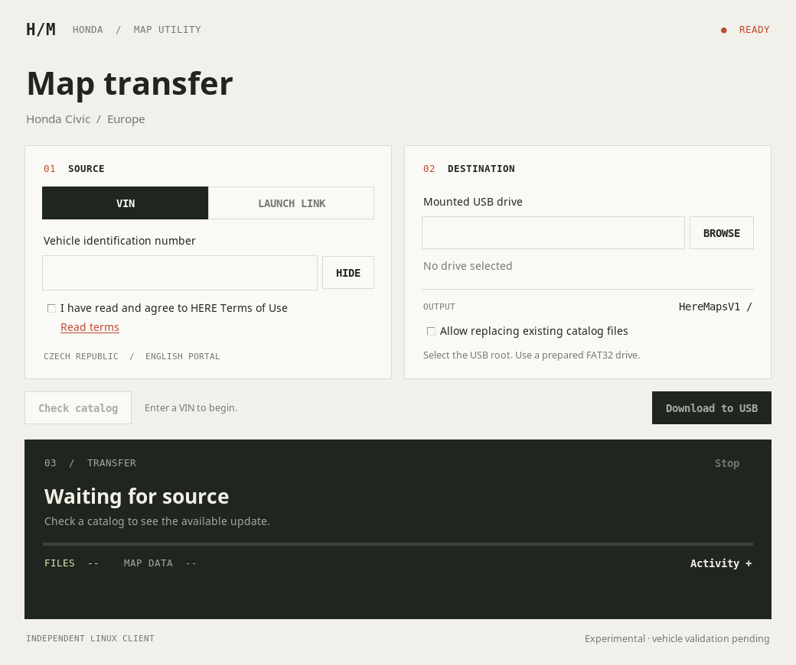

# Honda Map Downloader for Linux

An experimental, independent client for HERE Honda **bonneville EU** map updates, developed for a model year 2024 Civic. It runs natively in Python and requires neither Wine nor macOS. It is not an official HERE/Honda application or a complete replacement for every feature of the original downloader.

The client retrieves a catalog through the Czech/European VIN portal or a `heremapdownloaderv2://` launch link, downloads files to their catalog-defined paths, checks file sizes and MD5 hashes, and resumes interrupted transfers. It preserves the original `PACKAGE.SLIST` license file unchanged. It does not format USB drives.

## Interface



A quiet, utilitarian interface: warm paper, charcoal, a restrained accent, and three numbered sections. **SOURCE** selects VIN or a private launch link; **DESTINATION** selects the USB root; **TRANSFER** shows catalog size, completed-file progress, and clear operation status. **Activity** switches the transfer panel to a scrollable log without expanding the window.

The screenshot shows the actual idle Tk window on a virtual X display, with no private input or simulated map data. The interface uses system fonts and the Python standard library only.

## Install on Arch Linux

Download `honda-map-downloader-linux-0.2.0-1-any.pkg.tar.xz` from the [v0.2.0 release](https://github.com/habem86/wego-downloader/releases/tag/v0.2.0).

```bash
sudo pacman -S --needed python tk
sudo pacman -U ./honda-map-downloader-linux-0.2.0-1-any.pkg.tar.xz
honda-maps-gui
```

The package uses architecture `any` because it contains Python rather than architecture-specific machine code. Installation on an actual Arch system and execution on other CPU architectures have not yet been verified.

## Use the application

**Upgrade from v0.1.0:** that version omitted the release folder and wrote map files directly into the USB root. Do not use that layout for an in-car update. Version 0.1.1 creates `HereMapsV1` automatically and refuses the old root layout rather than moving or deleting your files. See [migration notes](USAGE.md#upgrading-from-v010).

1. Select **VIN** (Czech/European portal), enter your VIN, read the HERE terms, and confirm your own agreement. Alternatively, select **LAUNCH LINK** and paste a link issued by the official portal.
2. Select **Check catalog** to check update availability.
3. Prepare a blank, mounted **32 GB FAT32 USB drive** according to Honda's instructions. Choose the **root directory of the mounted USB**, not `/dev/sdX` or a subdirectory.
4. Select **Download to USB**. Map directories, `VRContext.Data`, and `PACKAGE.SLIST` go inside `HereMapsV1`, which is created automatically. The inspected catalog contained approximately 26.47 GB of map data.
5. After completion, safely eject the USB in Linux and follow Honda's in-vehicle update instructions.

VINs, launch links, catalogs, and license files are private. Do not post them in issues or public logs. They are not included in this repository or its release assets.

The client refuses to replace differing existing files unless you explicitly allow replacement. It does not remove old files outside the current catalog, so use a prepared blank drive. Interrupted map downloads can resume from `.honda-part` files. If a link expires, obtain a new one from the portal.

## Run from source

Requires Python 3.10+ and Tk for the graphical interface. There are no PyPI dependencies.

```bash
git clone https://github.com/habem86/wego-downloader.git
cd wego-downloader
python3 honda_maps_gui.py
```

Preview a catalog in the terminal:

```bash
python3 honda_maps.py
```

Download from the terminal; paste the launch link at the interactive prompt:

```bash
python3 honda_maps.py --download --dest /run/media/YOUR_USER/USB
```

See the [usage guide](USAGE.md) for VIN lookup from the terminal, browser integration, and troubleshooting.

## USB layout

For the inspected catalog (release `1`), the expected layout is:

```text
USB root/
└── HereMapsV1/
    ├── NavDB.CZE_1109/
    │   ├── 3DO.NDS
    │   ├── CONTENT.CFG
    │   ├── ...
    │   └── U1109/
    ├── other NavDB.* directories/
    ├── VRContext.Data/
    └── PACKAGE.SLIST
```

The folder combines `parameters.path` (default `HereMapsV`) and the distribution release identifier (`1`). `local-id` paths are relative to that folder. Select the USB root; do not manually select or nest `HereMapsV1`.

The vehicle-created `MapDownload_PortalSite.url` is outside the map download. The client leaves it and unrelated root items such as `LOST.DIR` untouched.

## Validation and limitations

- 21 automated tests cover HTTP 206 resume, servers ignoring Range, inconsistent ranges and MD5 failures, existing files, symbolic links, unsafe paths, FAT filename collisions, unchanged license bytes, and consent before VIN lookup.
- Live checks covered VIN lookup, European catalog retrieval, and sample downloads with matching MD5 hashes. A 1.46 MB file successfully resumed at byte 65,536 using HTTP 206.
- 11 GUI behavior tests pass on virtual displays with Tk 8.6 and Tk 9. They cover consent, source privacy, confirmation, progress counting, catalog invalidation, errors, cancellation, temporary-file handling, and activity visibility. The window has been rendered and visually checked at 1040×870 and 940×820.
- **A complete download, writing to a real FAT32 USB drive, installation on an actual Arch desktop, and acceptance by a vehicle have not been tested.** This is a prerelease for further validation.
- Only European bonneville NDS catalogs with `nds.file` and `nds.drm` relations are supported. Other catalogs are rejected before writing.
- The client does not bypass authorization or license protections. It uses download links issued by the official portal for an eligible vehicle.

See [VALIDATION.txt](VALIDATION.txt) for the recorded checks and coverage limits.

## Test and build

```bash
python3 -m unittest -v test_honda_maps.py
xvfb-run -a python3 -m unittest -v test_honda_maps_gui.py
python3 scripts/build_arch_package.py
```

The build creates an Arch package, a source archive, and `SHA256SUMS` in `dist/`. On Arch, you can alternatively run `makepkg -si`.

The MIT license covers this independent client only. It does not cover original HERE/Honda software, map data, licenses, or trademarks.
